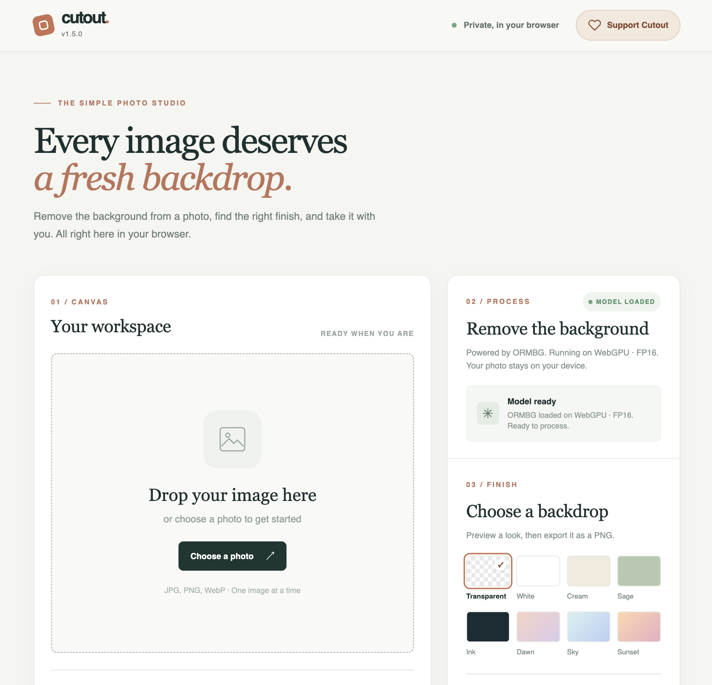

# Cutout · Private background removal

Remove a photo’s background, choose a fresh backdrop, and download a
full-resolution PNG—all in your browser. Your photo stays on your device.
Cutout is an open source, gift-supported studio built with Vue, Tailwind CSS,
and Transformers.js.

**[Open Cutout →](https://background-removal.pages.dev/)** · [Support the project ♡](#support-cutout)



*Screenshot supplied by Bob · Cutout v1.5.0, with no personal photo loaded.*

## Optional output framing

After processing a photo, open **Output frame** below the preview to try a new
aspect ratio with one tap on a visual ratio tile. Choose **Fit whole photo** to keep it all, or **Crop to fill** to
center-crop. Backdrops fill the selected output frame, and the shown pixel size
matches the PNG download and shared image.

The backdrop fills the workspace by default. Toggle **Download outline** beside
Output frame to see the exact saved area (the original photo bounds by default).
Selecting a new ratio reveals its outline automatically. This is a preview guide only. **Reset size** returns to the original dimensions;
changing photos resets framing too. New frames stay within the source pixel
budget and longest edge. Batch photos continue using their original dimensions.

## Support Cutout

If Cutout saves you time or helps you make something, please consider giving
back. Your gifts support continued development, mobile testing, and the care
that keeps this tool useful and open source. Single-photo editing stays free.

**[Open Cutout and choose “Support Cutout” →](https://background-removal.pages.dev/)**

Give with bitcoin by scanning the QR or copying the address in the app. Gifts
of **$10 USD or more** recognized through the app open saved brand backdrops,
batch processing, individual/shared batch finishes, and a local message notebook.
Notes stay on your device while message delivery is being built.

Cutout’s Bitcoin address:

```text
bc1q4009vd4j005r5hk5mlry29xu8j6yatv9k0mgp6fstl974zue04dq9e6zlx
```

We’ve recorded **26 human value blocks / $2,600** of contributed work toward our
voluntary gift-support baseline. Explore the [human value-block record](docs/HUMAN_VALUE_BLOCKS.md)
and the [giving guide](docs/GIVING.md). Gifts are voluntary, and the source remains
available under the [MIT License](LICENSE).

## Model lab · Experiments and comparisons

The lab is a separate workbench for exploring background-removal models,
quality, speed, and WebGPU/WASM behavior.

**[Open the model lab →](https://background-removal-lab.pages.dev/)** · [Lab documentation](lab/README.md)

For everyday photo editing, use [Cutout](https://background-removal.pages.dev/).
Both sites are hosted on Cloudflare Pages.

## Install or reuse

The stable app is an installable PWA with a home-screen icon, standalone window,
offline interface, and automatic updates when no photo is open. Open the live app in Safari on
iPhone/iPad and choose **Share → Add to Home Screen**, or use your desktop browser's
install action when available. Model loading and photo processing still require
a connection in this release; installation does not bundle the inference runtime
or model weights. See the [PWA guide](docs/PWA.md) for behavior and testing.

To make your own version, copy `main/` to a static HTTPS host, retain the license
notices, and customize the template, colors, and editable SVG logo. No build tool
or backend is required. The manifest and service worker use relative paths so
the app can be hosted at `/` or in a subdirectory. See the
[reuse and maintenance guide](docs/REUSING.md) for the file map and update checklist.

## Versions

| Folder | Purpose | Models and runtime |
| --- | --- | --- |
| [`main/`](main/) | Current stable no-build photo app | ORMBG, Transformers.js 4.3.0; WebGPU FP16 first, WASM Q8 fallback |
| [`lab/`](lab/) | No-build comparison workbench | ORMBG and BRIA on WASM/WebGPU; MODNet on WASM; Transformers.js 4.3.0 |
| [`archive/`](archive/) | Earlier Vite editions, source, and local build snapshots | ORMBG WASM and BRIA WebGPU/WASM on Transformers.js 3.8.1 |

The root is documentation only. `main/` is the single stable app location. See the [archive index](archive/README.md) for each earlier version and its history.

## Run locally

The no-build versions need a local HTTP server for ES modules and the model worker. From this folder:

```sh
python3 -m http.server 8765 --bind 127.0.0.1
```

Open `http://127.0.0.1:8765/main/` for the stable app or `http://127.0.0.1:8765/lab/` for comparisons. No npm install is needed for these two versions. The stable app bundles its UI libraries; model loading needs internet access for Transformers.js and model files. The lab still loads its UI libraries from CDNs. A file opened directly with `file://` will not run the worker.

### VS Code Live Server

Open `main/index.html` or `lab/index.html` with Live Server. The URL depends on the folder opened in VS Code and the server's port. If VS Code serves a parent workspace, the URL can include `Components/background-removal/main/index.html`. If it serves this repository directly, the path is `/main/index.html` or `/lab/index.html`.

Live Server serves the files without a build step. These apps use CDN libraries and downloaded model weights, so no-build does not mean fully offline. Direct `file://` access is unsupported; use Live Server, another local HTTP server, or an HTTPS host.

The model downloads are stored in the browser Cache Storage for the exact site origin. Both apps show the model cache and provide a clear button. If you serve both paths on the same host and port, they share that origin's model cache.

### Trouble opening the app in Safari?

If Cutout stays blank, open the separate [app recovery page](https://background-removal.pages.dev/recover.html)
and choose **Refresh app files** while online. It refreshes the installed interface
while keeping saved photos, backdrops, supporter access, and downloaded models.

## Versions and releases

`VERSION` is the authoritative semantic version, beginning at **v1.0.0**. The app
shows the running version below its name, in the footer, and in diagnostics.
Versioned pushes to `main` run checks and publish a matching GitHub tag/release
with changelog notes. See [CHANGELOG.md](CHANGELOG.md) and the
[release workflow](docs/VERSIONING.md).

## Publishing notes

### Human value and gift support

This is an open source, gift-supported project. We record the human attention
and effort contributed in [human value blocks](docs/HUMAN_VALUE_BLOCKS.md):
approximately one hour per block, valued at $100 toward a voluntary support
baseline. Through v1.5.0, the rounded working estimate is **26 blocks / $2,600**,
including **12 blocks / $1,200 on October 14, 2026** and the prior **14 blocks /
$1,400** baseline. The record includes direction, active monitoring, device testing,
and parallel project work, with whole-hour rounding when uncertain. The app now
includes bitcoin giving, portable supporter codes, saved brand backdrops, batch
processing, and a local message notebook. See the
[giving and supporter guide](docs/GIVING.md) for the flow and current limitations.

### Hosting and licensing

The stable app and comparison lab are both live at the links above. See [repository and hosting setup](docs/PUBLISHING.md) for the GitHub Desktop workflow and Cloudflare Pages settings.

The project's source is released under the [MIT License](LICENSE). Third-party libraries and model weights retain their own licenses. `main/` uses the [ORMBG ONNX model](https://huggingface.co/onnx-community/ormbg-ONNX), listed as Apache 2.0. `lab/` includes BRIA RMBG 1.4 for evaluation; its [separate license](https://huggingface.co/briaai/RMBG-1.4) restricts commercial use. See [lab model notes](lab/MODEL_NOTES.md) and [lab dependencies](lab/DEPENDENCIES.md) for the model and library details.

The Vite `dist/` folders are retained locally but ignored by Git because they are generated output. Their source and lockfiles remain available to rebuild them. `.DS_Store` and installed dependencies are also ignored.

## ORMBG model architecture

**ORMBG (Open Remove Background Model)** is a foreground segmentation model released by [schirrmacher](https://huggingface.co/schirrmacher/ormbg). Our browser app loads the [Transformers.js-ready ONNX conversion](https://huggingface.co/onnx-community/ormbg-ONNX). Both model pages currently list Apache 2.0; check the model repositories again before redistributing weights or publishing licensing claims.

The underlying neural network is **IS-Net**, from the [Highly Accurate Dichotomous Image Segmentation paper](https://www.ecva.net/papers/eccv_2022/papers_ECCV/papers/136780036.pdf). It is a convolutional, U²-Net-style encoder and decoder with nested residual U-blocks (RSUs). An initial stride-2 convolution reduces the spatial size before the encoder; the decoder combines features from several scales to recover foreground details. The IS-Net training method adds supervision on intermediate features as well as segmentation masks. A separate ground-truth encoder helps train the image segmentation network; only the image segmentation network is used for inference. ORMBG adapts this design and is [optimized for images with people](https://huggingface.co/schirrmacher/ormbg).

The `ViTFeatureExtractor` name in the [conversion's preprocessing config](https://huggingface.co/onnx-community/ormbg-ONNX/blob/main/preprocessor_config.json) is a library interface label. The model is **not a Vision Transformer**. Transformers.js is the JavaScript library that loads and runs its ONNX graph.

### From photo to PNG in this app

| Step | What happens |
| --- | --- |
| Prepare | The main app draws a 1024 × 1024 model input and a small display preview, then closes the full-resolution decoded image before transferring the input pixels to the worker. Transformers.js converts the input to RGB and rescales values to 0–1. The published preprocessing config does not apply mean/std normalization. |
| Predict | IS-Net estimates a soft foreground mask, rather than classifying the photo or generating a new image. |
| Restore size | Our worker extracts the foreground mask from the pipeline result. The app reopens the retained original file and resizes the mask to its full photo dimensions. |
| Export | The app applies the mask to the original photo with Canvas compositing, then optionally adds a selected color or gradient and creates a full-resolution PNG for download or native file sharing. |

The stable implementation lives in [`main/model.worker.js`](main/model.worker.js) and [`main/app.js`](main/app.js); the Vite edition is preserved separately in [`archive/ormbg-vite-wasm/src/`](archive/ormbg-vite-wasm/src/). The worker runs the `background-removal` pipeline on WebGPU with FP16 weights when possible. It switches to WASM with Q8 weights if GPU loading or inference fails. The corresponding [ONNX files](https://huggingface.co/onnx-community/ormbg-ONNX/tree/main/onnx) are approximately 88.1 MB and 44.3 MB. The model downloads on first use and is kept in this browser origin's Cache Storage until the user clears it. The original photo is processed in the browser.

ORMBG's upstream model card describes its human-focused training and research. Results on products, animals, transparent objects, or crowded scenes should be assessed with representative images before making quality claims. WebGPU was faster in our local comparisons, while WASM provides a fallback for unsupported or incompatible GPU paths. Performance varies by browser and device.

The stable app includes **Share / Save…**, when file sharing is supported, and **Help & diagnostics** for mobile troubleshooting. See [mobile testing notes](docs/MOBILE_TESTING.md) for capturing failures and trying WASM after an interrupted session.

### Sources and credit

- [Original ORMBG model, training notes, and license](https://huggingface.co/schirrmacher/ormbg)
- [ONNX conversion, model files, and license](https://huggingface.co/onnx-community/ormbg-ONNX)
- [IS-Net research paper by Qin et al. (ECCV 2022)](https://www.ecva.net/papers/eccv_2022/papers_ECCV/papers/136780036.pdf)
- [DIS / IS-Net research code](https://github.com/xuebinqin/DIS)
