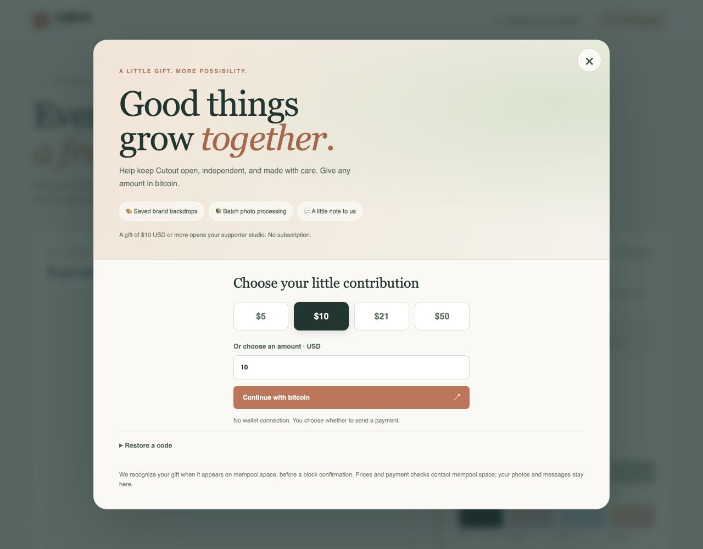

# Giving & the supporter studio

Cutout v1.1.0 adds a local-first, gift-supported studio. The regular single-photo
workflow remains freely available. A gift of **$10 USD or more** opens saved brand
backdrops, batch processing, and the message notebook. There is no subscription
or remote account service.



[Phone payment preview](images/cutout-giving-phone.png). Screenshots illustrate
the interface; create your own current payment request in the app before giving.

## Give a little bitcoin

Use **Give & grow** in the header or the giving card below the workspace.
Choose $5, $10, $21, $50, or a custom USD amount. The app reads a current BTC/USD
quote from mempool.space, creates a payment request, and saves it before showing
its QR code. QR Code Styling 1.9.2 is bundled locally with its license notices.

Cutout’s mainnet, on-chain Bitcoin address:

```text
bc1q4009vd4j005r5hk5mlry29xu8j6yatv9k0mgp6fstl974zue04dq9e6zlx
```

Scan the styled QR, open the wallet link, or copy the address **and exact BTC
amount**. The QR and wallet link contain a BIP21 URI with that address and amount.
A random 1–99 sats are added to the rounded-up requested value to help distinguish
requests sharing the same address. The displayed USD estimate includes those
extra sats; wallet fees are separate. This flow supports on-chain Bitcoin, not
Lightning invoices. The app never connects to a wallet or sends a payment itself.

The app checks address transactions approximately every 20 seconds while visible
and supports a manual check. It accepts a matching **unconfirmed mempool payment**
or a newly confirmed payment. Existing transaction IDs captured when preparing
that request are excluded, and old confirmed transactions are rejected by block
time. Outputs to the configured address must total the exact requested sats.
If multiple transactions match, the donor must supply their transaction ID.
A transaction ID can also recover a gift no longer on the latest address page
or one whose amount was changed by the wallet. For an explicitly entered ID,
the recipient, baseline, and time checks still apply, but the actual amount is
used to calculate supporter eligibility against the request’s saved USD quote.

The USD quote is fixed when the request is created and expires for new sending
after 30 minutes. Matching continues afterward so a delayed payment can still be
recognized at the original quoted value. If you have already sent bitcoin, keep
that request. A fresh request uses a new amount. Smaller gifts are thanked but
do not open the $10 supporter features; separate small gifts are not accumulated
in this initial version.

Network errors, stale prices, API throttling, and missing IndexedDB prevent a new
request from being presented as ready. Closing the dialog does not discard it.
Reloading resumes an outstanding request. Phone/PWA suspension pauses checks;
checks resume while the app is visible again.

## Keep your little key

Before payment, **Save code** downloads a `CUTOUTGIFT1.…` gift recovery code. It
restores that pending request in another installation, including the amount and
baseline transaction IDs. Save it before paying if you may switch devices.

After a qualifying payment is seen, the app generates a `CUTOUT1.…` supporter
code, stores it in IndexedDB, and offers copying and a text-file download. Open
**Restore a code** elsewhere and paste the code or choose its saved text file.
A new installation checks the referenced transaction and recipient/amount with
mempool.space before saving the local upgrade. Once stored, the upgrade opens
without needing to re-enter the code or recheck the network each launch.

Codes are intentionally portable and shareable. **They are unsigned honor-system
receipts, not secure licenses or proof that the person presenting them paid.**
Their quote information is client-side and can be altered. With one public static
address, two requests can occasionally collide on an amount, and public payments
can be claimed by someone else. Baseline snapshots, distinctive amounts, and
transaction checks reduce accidental matches; they cannot establish ownership.
A future service with unique invoices/addresses and signed receipts would be
needed for reliable attribution or enforcement.

Mempool recognition is provisional, not a block confirmation. A transaction can
be replaced or dropped later. This initial build honors the local upgrade once
given; it does not revoke it. Restoring a code whose transaction is no longer
available will fail until a matching valid receipt is used.

The app requests persistent browser storage after an upgrade, but browsers can
still deny persistence or clear site data. Keep a backup of the code. Presets,
messages, and saved outputs remain on their original browser/origin; a supporter
code restores the upgrade, not those files.

## Saved brand backdrops 🎨

Expand **Your saved brand backdrops** in Finish. Name a solid color, a two-color
gradient, or an image and save it. Saved choices appear alongside the built-in
swatches and survive reloads. Up to 20 presets are supported.

Backdrop images accept files up to 10 MB, are resized to at most 1600 px, and are
stored as JPEGs. They fill the photo with a centered crop, matching the preview
and full-size PNG composition. The original foreground export retains its full
photo dimensions. Remove unused presets from the saved list.

## Batch workspace 📚

Choose a backdrop first, then **Choose a batch of photos** below the canvas.
Select up to 20 image files, at most 40 MB each and 200 MB total input. Cutout
processes one photo at a time through the existing pipeline. Every inference
gets a fresh worker, and its model runtime is released before full-size export.
Each PNG must successfully commit to IndexedDB before that photo is cleared.

The local output shelf holds up to 100 outputs or 200 MB. Download images
individually, then explicitly remove their shelf copies when finished. Downloading
does not delete a copy automatically: browsers cannot reliably tell us that a
file reached its destination. There is no ZIP export in this first version.

**Pause after this photo** finishes and stores the current output, then stops.
An inference failure pauses the batch; use the normal WASM retry on the current
photo. Storage failure also pauses with the current export retained in the
workspace, so it can be downloaded directly. Already saved outputs remain on the
shelf. Choose any remaining source files again to continue; the source queue is
in memory and is not resumed across reloads. Keep the app open while processing.

## Message notebook 💬

Supporters can save a short message (up to 1,000 characters), optionally including
the current diagnostics report. The attachment can be reviewed before saving.
Photos and filenames are excluded by the diagnostics system.

Messages are marked **saved locally**, can be downloaded as JSON, and can be
deleted. **Nothing is sent to the project owner yet.** Future delivery, possibly
through Plunk, needs a separate service. No API secret belongs in this browser
app. The saved record already includes a creation time, text, optional diagnostic
report, transaction reference, and delivery status for a future adapter.

## Storage, privacy, and updates

The `cutout-local` IndexedDB database has `settings`, `presets`, `outputs`, and
`messages` stores. Gift requests, receipts, and supporter codes use `settings`.
Clearing the **model cache** does not clear this database. PWA shell upgrades
also preserve it. Photo inference retains its existing browser-only behavior.

Giving sends public address/transaction lookups and reads a USD price from
mempool.space. Photo processing separately uses the existing model/runtime
providers. Message text, diagnostics, presets, and output photos are not uploaded.
PWA updates wait while the giving dialog is open, a preset is saving, a batch is
running, or the normal image session is active.

## Verification before publishing

Run the release check and Node tests. Tests cover quote freshness, payment
matching, malformed/under-threshold codes, receipt lookup, batch limits, storage
failure, centered image crops, offline shell assets, safe updates, and fresh
worker disposal across batch photos. Simulated payment browser checks must run
in an isolated preview; never add a fake payment or development unlock to `main/`.

Also test on an actual iPhone/PWA: scan with a separate wallet, save/restore the
code, process several real photos in a batch, download outputs, and reopen the
app. Automated desktop/browser checks do not establish iPhone memory reliability.
No real payment is made by the automated checks.

Sources: [QR Code Styling](https://github.com/kozakdenys/qr-code-styling),
[mempool REST API](https://mempool.space/docs/api/rest), and the underlying
[Esplora transaction/address API](https://github.com/Blockstream/esplora/blob/master/API.md).

### Implementation checks · October 14, 2026

- All 19 Node tests and the v1.1.0 release consistency check passed.
- A live mempool price/address lookup produced the displayed QR and payment URI.
- An isolated browser fixture simulated a qualifying mempool payment, automatic
  unlock, code restoration, and a reload with the upgrade preserved.
- The browser saved a message with diagnostics, a gradient preset, and an image
  preset. Two actual model inferences stored batch PNGs, which survived reload.
  A separate actual inference exported with the saved image backdrop.
- Desktop and 390 px phone layouts were inspected; address copying and the sticky
  close control were checked. Blob-download behavior is covered by the DOM helper
  test; the in-app browser did not expose a completed code-download event.

An actual Bitcoin payment and physical iPhone/PWA batch/download checks remain
for the owner’s live testing. No bitcoin was sent during implementation.
